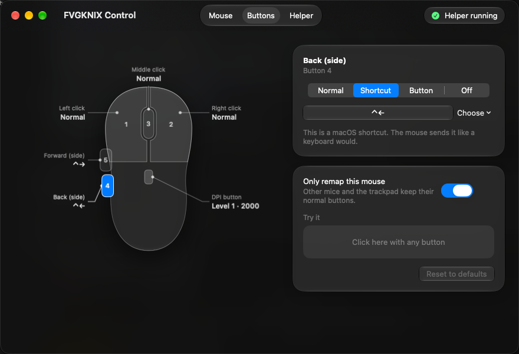
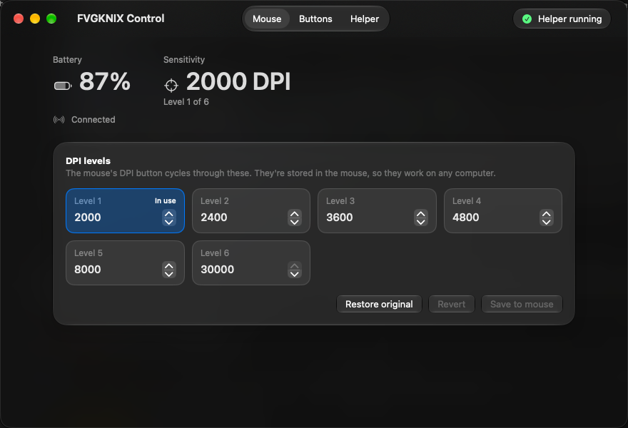

# FVGKNIX Control

A small, native replacement for the vendor's **WebDriver For Mac** for IGNIX wireless mice on macOS. It remaps the mouse's buttons, shows its battery level and edits its DPI levels, without the vendor driver, a browser or a third-party remapping app.

> [!NOTE]
> **Why this exists.** I bought an IGNIX F5 from the VortexSeries Official Store on Shopee, whose listing said the mouse supports Mac. In practice the vendor's WebDriver For Mac didn't work: the mouse showed up as an F3 instead of an F5, so its settings couldn't be changed or saved. This project replaces the driver for that mouse. If your F5 or other IGNIX mouse has the same problem on a Mac, this may help.

> [!NOTE]
> This is an unofficial project, not affiliated with or endorsed by IGNIX or the receiver's maker. It was built from the protocol notes in [`docs/protocol.md`](docs/protocol.md).





## Features

- **Remap any of the five buttons** to a keyboard shortcut, another mouse button, or nothing. By default the side buttons send ⌃← and ⌃→, to switch Spaces.
- **Only this mouse:** other mice and the trackpad keep their normal buttons.
- **Battery and current DPI level,** read straight from the receiver.
- **Edit the DPI levels** stored in the mouse (100–30000 in steps of 50). Every write is read back and checked, and the first table read from the mouse is kept so you can restore it.
- **Lock-out guard:** if no button would send a left click, button 1 stays Left click.

It has two parts:

- **`ignix-remap`**, a background helper started at login. It does the remapping and all communication with the mouse.
- **FVGKNIX Control**, a settings app. It edits the helper's config and needs no permissions of its own.

## Supported hardware

| | |
| --- | --- |
| Receiver | LXDDZ "2.4G Wireless Device", USB vendor id `0x1D57`, product id `0xFA60` |
| Tested mouse | Device id `0xAE` (174), firmware `0x0104`, 5 buttons |

Other mice on the same receiver may work for remapping. DPI editing has only been worked out for the mouse above.
To check your receiver, open System Information › USB and look for vendor id `0x1d57`, product id `0xfa60`.

## Requirements

- macOS 26 or later is recommended. It is built and tested only on macOS 27.2. The code has fallbacks for macOS 14 and 15 (standard materials instead of Liquid Glass), but they have not been run.
- Swift compiler from the Xcode Command Line Tools: `xcode-select --install`

## Install

1. Quit WebDriver For Mac and any other app that remaps mouse buttons.
2. Clone this repository, then run:

   ```sh
   make install
   ```

   This builds and installs the helper to `~/.local/bin/ignix-remap`, starts it as a LaunchAgent, and installs **FVGKNIX Control** to `~/Applications`.
3. Grant the helper both permissions in System Settings › Privacy & Security:
   - **Accessibility**, to change button presses
   - **Input Monitoring**, to read the receiver

   If `ignix-remap` isn't listed, click **+**, press ⌘⇧G and enter `~/.local/bin/ignix-remap`.
4. In FVGKNIX Control, open the **Helper** tab and click **Restart helper**. The toolbar should read "Helper running".

You can also install the parts separately, with `make helper` or `make app`.

### After updating

`make helper` replaces the helper only when the build changed. A new binary has an ad hoc signature, so macOS stops honouring the old permission entries even though they still look enabled. Remove `ignix-remap` from Accessibility and from Input Monitoring, add it again, then restart the helper.

## Usage

The app has three tabs. The toolbar shows whether the helper is running.

| Tab | What it does |
| --- | --- |
| **Mouse** | Battery, current sensitivity and the DPI levels. Edit a level and click **Save to mouse**, or **Restore original** to write back the first table read. The mouse's DPI button cycles through these levels. |
| **Buttons** | A drawing of the mouse with a label on each button showing what it does now. Click a button, then choose Normal, Shortcut, Button (act as another button) or Off. The "Try it" area shows what a press sends. |
| **Helper** | A checklist: installed, running, Accessibility, Input Monitoring, with a button to fix each one. |

Changes to buttons apply immediately; no restart is needed.

The app is dark only. It uses Liquid Glass on macOS 26 and later. On macOS 14 and 15 it should fall back to standard materials, but that is untested.

> [!WARNING]
> DPI writing uses a protocol worked out by reverse engineering. It has been tested on the one mouse listed above. Each write is checked by reading the table back, and **Restore original** writes back the first table read from your mouse.

## Uninstall

```sh
make uninstall
```

This removes the helper, its LaunchAgent and log, the app and all IGNIX settings. Then remove `ignix-remap` from Accessibility and Input Monitoring in System Settings.

## How it works

- An **event tap** rewrites button presses in place. A press and its release always get the same action, even if the config changes in between.
- **IOHIDManager** matches the receiver's mouse interface, to tell its presses apart from other mice, and its config interface (usage page 1, usage `0x80`).
- The mouse sends **battery and DPI-level reports** on the config interface every 2 seconds, with no request needed.
- Settings are **read with the handshake** the vendor's Windows driver uses: `SetReport 0xA0`, wait for "ready", then `GetReport`. The DPI table is written as feature report `0x04` with a checksum.
- The app and the helper share files in `~/Library/Application Support/IGNIX/` and signal each other with Darwin notifications.

The full protocol is in [`docs/protocol.md`](docs/protocol.md).

## Project layout

| Path | Contents |
| --- | --- |
| `helper/` | The `ignix-remap` helper and its LaunchAgent template |
| `app/` | The FVGKNIX Control SwiftUI app; `MouseDiagram.swift` holds the mouse drawing |
| `shared/` | Code used by both: the config, status and DPI table format |
| `scripts/` | Install and uninstall scripts, called by the `Makefile` |
| `tools/probe.swift` | `make probe`: a read-only command-line probe for the receiver |
| `tools/driver-read.mjs` | Reads settings through WebDriver For Mac, for comparing against the vendor driver (Node.js) |
| `docs/` | Protocol notes and a raw capture of every setting |

## Troubleshooting

The helper's log is at `~/Library/Logs/ignix-remap.log`.

| Symptom | Fix |
| --- | --- |
| Side buttons still go Back and Forward | The helper lacks Accessibility. Re-add it (see "After updating") and restart it. |
| "Waiting for the mouse" or no battery | The helper lacks Input Monitoring, or started before it was granted. Grant it and click **Restart helper**. |
| No DPI table | Move the mouse to wake it, then restart the helper. |

## Contributing

Issues and pull requests are welcome, especially captures from other IGNIX models. `make probe` builds a read-only tool that never writes to the mouse; its output is the most useful thing to attach.

## License

[MIT](LICENSE)
